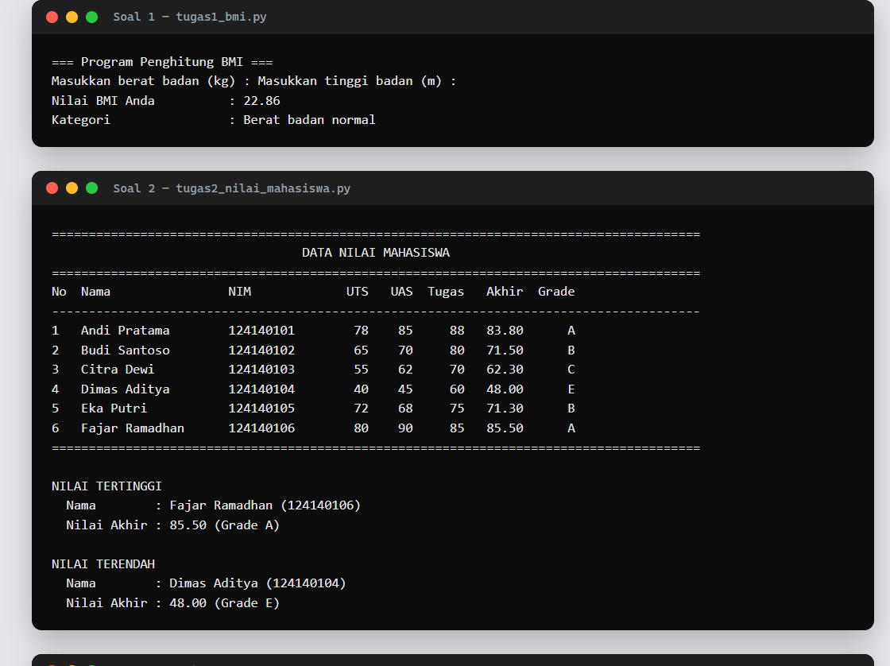
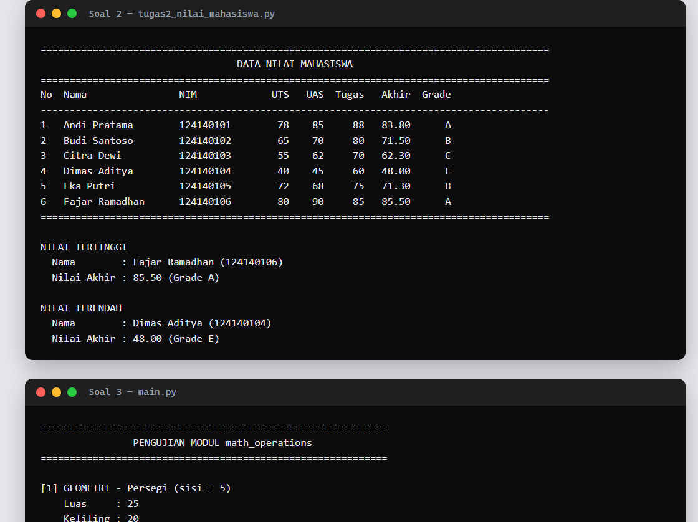
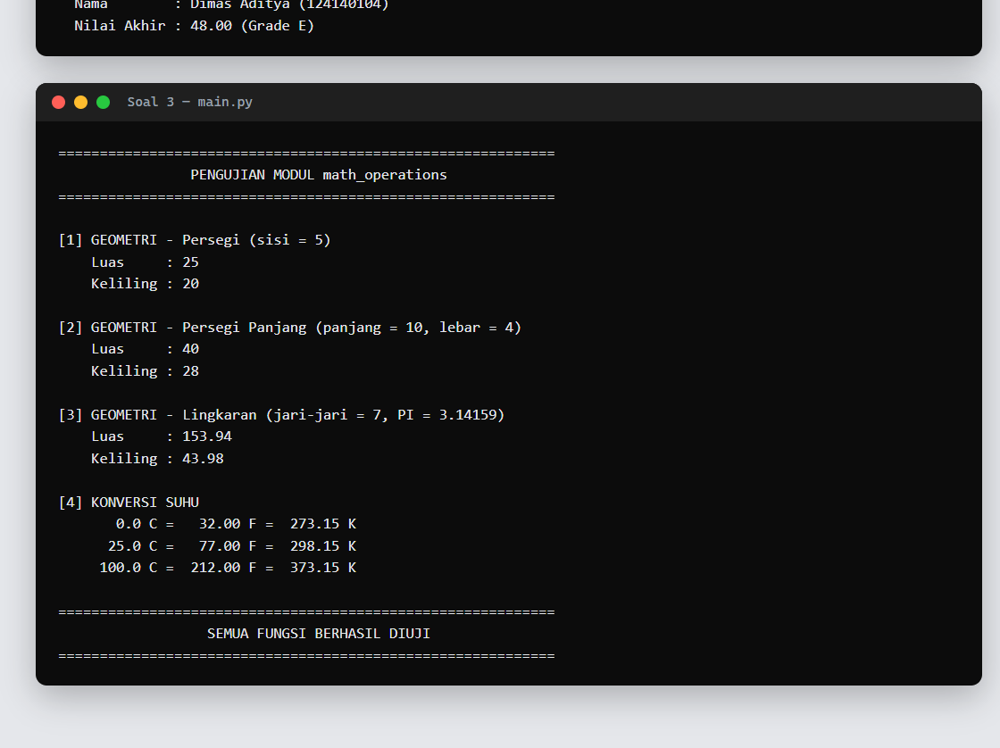

# Tugas Praktikum — Dasar Pemrograman Python

## 👤 Identitas Mahasiswa

| | |
| --- | --- |
| **Nama** | Refin Agus Saputra |
| **NIM** | 124140126 |
| **Kelas** | Praktikum Pemrograman Web |

Repositori ini berisi pengerjaan tugas praktikum Python yang menguji
pemahaman mengenai: **variabel, struktur kendali (if-elif-else dan loop),
modularitas fungsi, struktur data koleksi (list & dictionary), serta
pembuatan modul kustom**.

## 📂 Struktur Folder

```
pemrograman_web_itera_124140126/
└── REFIN_124140126/
    ├── .gitignore                    # venv/, __pycache__/ tidak ikut di-commit
    ├── README.md                     # Dokumentasi tugas (file ini)
    ├── tugas1_bmi.py                 # Soal 1 — Penghitung BMI Sederhana
    ├── tugas2_nilai_mahasiswa.py     # Soal 2 — Pengelolaan Data Nilai Mahasiswa
    ├── math_operations.py            # Soal 3 — Modul matematika kustom
    ├── main.py                       # Soal 3 — Program utama pemanggil modul
    └── docs/                         # Bukti hasil eksekusi (txt + screenshot)
```

---

## 🧮 Soal 1 — Program Penghitung BMI (30%)

**Berkas:** `tugas1_bmi.py`

### Alur kerja
1. Variabel `berat` (kg) dan `tinggi` (m) diisi oleh pengguna melalui `input()`.
2. Fungsi `hitung_bmi(berat, tinggi)` menghitung BMI dengan rumus
   **BMI = berat / (tinggi × tinggi)**.
3. Fungsi `tentukan_kategori(bmi)` menentukan kategori dengan percabangan
   `if-elif-else`:
   | Kriteria | Kategori |
   | --- | --- |
   | BMI < 18.5 | Berat badan kurang |
   | 18.5 ≤ BMI < 25 | Berat badan normal |
   | 25 ≤ BMI < 30 | Berat badan berlebih |
   | BMI ≥ 30 | Obesitas |
4. Hasil BMI dicetak **2 angka desimal** dengan f-string (`{bmi:.2f}`)
   beserta kategori status berat badannya.

### 📸 Screenshot hasil eksekusi
(Contoh uji: berat 70 kg, tinggi 1.75 m → BMI 22.86 — Berat badan normal)



---

## 🎓 Soal 2 — Program Pengelolaan Data Nilai Mahasiswa (30%)

**Berkas:** `tugas2_nilai_mahasiswa.py`

### Alur kerja
1. **List** `MAHASISWA` memuat **6 dictionary** data mahasiswa (minimal 5),
   dengan kunci: `nama`, `nim`, `nilai_uts`, `nilai_uas`, `nilai_tugas`.
2. `hitung_nilai_akhir(uts, uas, tugas)` menghitung nilai akhir sesuai bobot:
   **(30% × UTS) + (40% × UAS) + (30% × Tugas)**.
3. `tentukan_grade(nilai_akhir)` menentukan grade:
   | Grade | Kriteria |
   | --- | --- |
   | A | Nilai akhir ≥ 80 |
   | B | 70 ≤ Nilai akhir < 80 |
   | C | 60 ≤ Nilai akhir < 70 |
   | D | 50 ≤ Nilai akhir < 60 |
   | E | Nilai akhir < 50 |
4. `tampilkan_tabel()` mencetak seluruh data (Nama, NIM, Nilai Akhir, Grade)
   dalam **tabel rapi** menggunakan perataan f-string (`:<n` rata kiri,
   `:>n` rata kanan).
5. `tampilkan_nilai_ekstrem()` menggunakan fungsi bawaan `max()` dan `min()`
   (dengan argumen `key=lambda`) untuk mencari dan menampilkan mahasiswa
   **nilai tertinggi** dan **terendah**.

### 📸 Screenshot hasil eksekusi



---

## 🧰 Soal 3 — Modul Matematika Python (30%)

**Berkas:** `math_operations.py` (modul) dan `main.py` (program utama)

### Deskripsi fungsi pada `math_operations.py`

| Fungsi | Keterangan |
| --- | --- |
| `luas_persegi(sisi)` / `keliling_persegi(sisi)` | Luas & keliling persegi |
| `luas_persegi_panjang(panjang, lebar)` / `keliling_persegi_panjang(panjang, lebar)` | Luas & keliling persegi panjang |
| `luas_lingkaran(jari_jari)` / `keliling_lingkaran(jari_jari)` | Luas & keliling lingkaran (memakai konstanta `PI = 3.14159`) |
| `celsius_ke_fahrenheit(celsius)` | Konversi °C → °F, rumus `(°C × 9/5) + 32` |
| `celsius_ke_kelvin(celsius)` | Konversi °C → K, rumus `°C + 273.15` |

Setiap fungsi dilengkapi **docstring** (penjelasan parameter `Args` dan
nilai kembalian `Returns`), dan modul memiliki **konstanta `PI = 3.14159`**.

### Dua cara impor berbeda di `main.py`
1. `import math_operations` → fungsi dipanggil via nama modul
   (`math_operations.luas_persegi(5)`).
2. `from math_operations import celsius_ke_fahrenheit, celsius_ke_kelvin` →
   fungsi dipanggil langsung (`celsius_ke_fahrenheit(25)`).

`main.py` memanggil **seluruh** fungsi modul dengan berbagai nilai pengujian
(dengan loop untuk pengujian konversi suhu) dan menampilkan hasil kalkulasi
dengan format rapi dan terstruktur.

### 📸 Screenshot hasil eksekusi



---

## ▶️ Cara Menjalankan di VS Code / Terminal

> Persiapan: buka folder project di VS Code, lalu buka terminal
> (`Ctrl + ` `). Pastikan Python 3 sudah terpasang (`python --version`).

Di dalam folder `REFIN_124140126/`, jalankan satu per satu:

```bash
# Soal 1 — Penghitung BMI
python tugas1_bmi.py
# Program meminta input berat (kg) dan tinggi (m), contoh: 70 lalu 1.75

# Soal 2 — Pengelolaan Data Nilai Mahasiswa
python tugas2_nilai_mahasiswa.py
# Langsung menampilkan tabel data nilai beserta nilai tertinggi & terendah

# Soal 3 — Modul Matematika
python main.py
# Menampilkan hasil uji seluruh fungsi math_operations
```

Atau lewat tombol **Run Python File** (▶) di pojok kanan atas editor VS Code.

### Menggunakan Virtual Environment (opsional)

Di root repositori sudah disediakan folder `venv/` dan dikecualikan dari Git
melalui `.gitignore`. Cara pakai:

```bash
# Windows PowerShell
python -m venv venv            # hanya jika belum ada
.\venv\Scripts\Activate.ps1    # aktifkan virtual environment
python tugas1_bmi.py           # jalankan program di dalam venv
deactivate                     # keluar dari venv

# Windows CMD
venv\Scripts\activate.bat

# Linux/macOS
source venv/bin/activate
```

## 📁 Bukti Eksekusi Lainnya

Selain screenshot di atas, output mentah hasil eksekusi ketiga program di
terminal juga tersimpan dalam format teks:

- [`docs/output-soal1.txt`](docs/output-soal1.txt)
- [`docs/output-soal2.txt`](docs/output-soal2.txt)
- [`docs/output-soal3.txt`](docs/output-soal3.txt)

## ✅ Ketentuan yang Dipenuhi

- [x] Docstring pada setiap fungsi (parameter & nilai kembalian)
- [x] Kode mematuhi PEP 8 (indentasi 4 spasi, penamaan `snake_case`)
- [x] `if __name__ == "__main__":` pada setiap berkas skrip
- [x] `.gitignore` (folder `venv/` dan `__pycache__/` tidak ikut diunggah)
- [x] README berisi identitas, deskripsi alur kerja, cara menjalankan, dan screenshot
