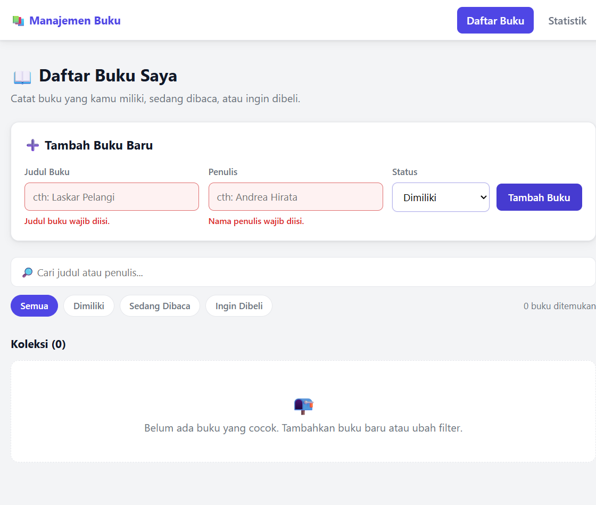
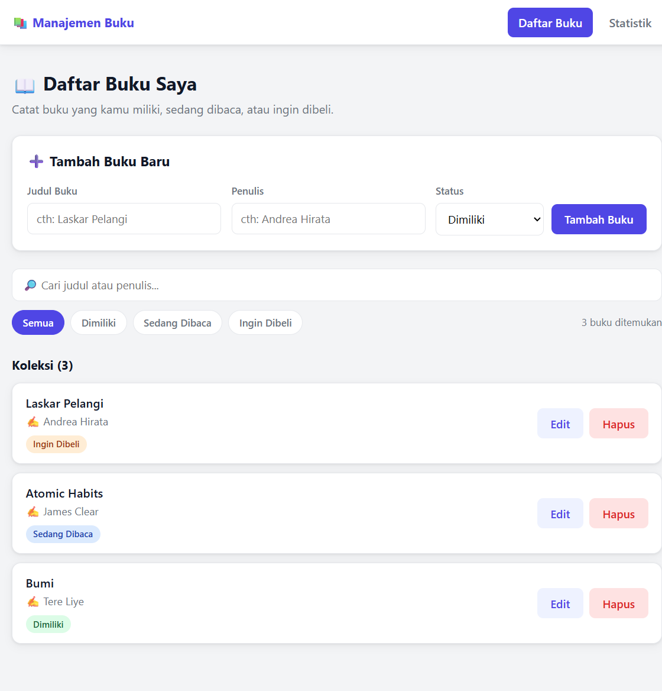
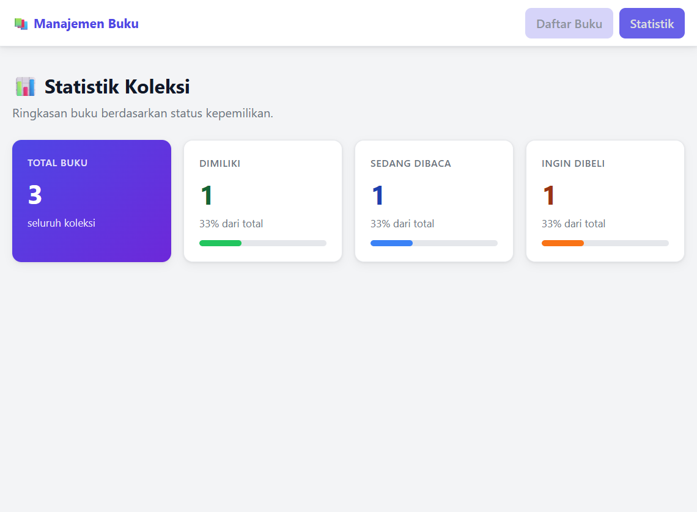

# 📚 Aplikasi Manajemen Buku Pribadi

Tugas Pertemuan 3 — Mata Kuliah Pengembangan Aplikasi Berbasis Web (React)

**Nama : Refin Agus Saputra**
**NIM : 124140126**

Aplikasi manajemen buku pribadi yang memungkinkan pengguna mencatat buku-buku
yang **dimiliki**, **sedang dibaca**, atau **ingin dibeli**. Data tersimpan
persisten di `localStorage` sehingga tidak hilang saat halaman di-refresh.

---

## ✨ Fitur

| Fitur | Keterangan |
| --- | --- |
| ➕ Tambah buku | Input judul, penulis, dan status (milik / baca / beli) |
| ✏️ Edit buku | Klik tombol *Edit* → form terisi otomatis → simpan perubahan |
| 🗑️ Hapus buku | Klik tombol *Hapus* pada kartu buku |
| 🔎 Pencarian | Cari berdasarkan **judul** atau **nama penulis** |
| 🏷️ Filter status | Filter: Semua / Dimiliki / Sedang Dibaca / Ingin Dibeli |
| 📊 Halaman statistik | Total buku, jumlah & persentase tiap status dengan progress bar |
| 💾 Penyimpanan persisten | Seluruh data buku disimpan di `localStorage` |
| ⚠️ Validasi form | Kolom wajib diisi dengan feedback visual (border merah + pesan error) |

## 🖼️ Screenshot Antarmuka

**1. Form validasi — feedback visual saat kolom kosong:**



**2. Daftar buku (tambah, edit, hapus, filter, dan pencarian):**



**3. Halaman statistik:**



## 🛠️ Teknologi

- **React 19** (Vite) — functional components + Hooks
- **React Router DOM** — navigasi multi-halaman (`/` dan `/stats`)
- **Context API** — state management global untuk data buku
- **PropTypes** — type checking pada seluruh komponen
- **Vitest + React Testing Library + jsdom** — unit testing
- **localStorage** — penyimpanan data persisten

## 🚀 Instalasi & Cara Menjalankan

Pastikan Node.js (v18+) dan npm sudah terpasang.

```bash
# 1. Masuk ke folder project
cd REFIN_124140126_pertemuan3

# 2. Install dependensi
npm install

# 3. Jalankan aplikasi (development server)
npm run dev
# Buka http://localhost:5173 di browser

# 4. Jalankan unit test
npm run test:run

# 5. Build untuk production (opsional)
npm run build
```

## 🧪 Laporan Testing

Unit test dijalankan dengan **Vitest + React Testing Library**.
Hasil eksekusi di terminal (`npm run test:run`):

```
 RUN  v5.0.5 C:/Users/ASUS/OneDrive/ドキュメント/Default Project/REFIN_124140126_pertemuan3

 Test Files  6 passed (6)
      Tests  23 passed (23)
   Start at  10:42:24
   Duration  3.75s (environment 69%, setup 17%, tests 10%, transform 2%, import 1%, worker 1%)
```

> Output lengkap tersimpan di [`docs/testing-output.txt`](docs/testing-output.txt).

Cakupan test (23 test, 6 file):

| File test | Yang diuji |
| --- | --- |
| `BookForm.test.jsx` | Render kolom form, **validasi kolom wajib + feedback visual**, submit data valid (nilainya di-trim), mode edit (prefill `initialData`) |
| `BookList.test.jsx` | Render daftar + badge status, empty state, callback `onEdit` / `onDelete` dengan argumen yang benar |
| `BookFilter.test.jsx` | Render tombol filter, callback pencarian & filter, class `active` pada filter terpilih |
| `useBookStats.test.js` | Perhitungan jumlah & persentase per status, edge case daftar kosong / `undefined` |
| `useLocalStorage.test.js` | Nilai awal, memuat data tersimpan, **persistensi otomatis ke localStorage**, fungsi `reset` |
| `Home.test.jsx` | **Integrasi end-to-end**: tambah → tampil, edit → berubah, hapus → hilang, filter + pencarian kombinasi |

## 🗂️ Struktur Folder

```
src/
├── components/          # Komponen reusable
│   ├── BookForm/        #   Form tambah/edit buku + validasi
│   ├── BookList/        #   Daftar buku + badge status + aksi
│   └── BookFilter/      #   Pencarian + filter status
├── pages/               # Halaman (React Router)
│   ├── Home/            #   Halaman utama daftar buku
│   └── Stats/           #   Halaman statistik
├── hooks/               # Custom hooks
│   ├── useLocalStorage.js  # Sinkronisasi state ↔ localStorage
│   └── useBookStats.js     # Perhitungan statistik buku
├── context/
│   └── BookContext.jsx  # Context API: state global buku
├── __tests__/           # 23 unit test (Vitest + RTL)
├── App.jsx              # Setup React Router + Navbar
├── App.css
├── main.jsx             # Entry point (BookProvider membungkus App)
├── index.css            # Style global
└── setupTests.js        # Setup jest-dom matchers untuk test
```

## ⚛️ Penjelasan Fitur React yang Digunakan

### 1. `useState` dan `useEffect`
- **`useState`** dipakai di seluruh komponen: state form (`BookForm`), filter/pencarian/buku yang sedang diedit (`Home`), dan state dalam custom hook `useLocalStorage`.
- **`useEffect`** dipakai untuk:
  - Menulis nilai state ke `localStorage` setiap kali berubah (`useLocalStorage.js`) — inilah kunci persistensi data.
  - Mengatur judul tab browser (`Home.jsx`).

### 2. Custom Hooks (2 buah)
- **`useLocalStorage(key, initialValue)`** — mengembalikan `[value, setValue, reset]`; membaca localStorage saat inisialisasi (lazy initializer) dan menulisnya kembali di `useEffect`. Dipakai oleh `BookContext` untuk menyimpan daftar buku.
- **`useBookStats(books)`** — menghitung total, jumlah per status, dan persentase dengan `useMemo` agar efisien. Dipakai oleh halaman `Stats`.

### 3. Context API (state management)`BookContext.jsx` menyediakan `books`, `addBook`, `updateBook`, dan `deleteBook`
melalui `BookProvider` yang membungkus seluruh aplikasi (`main.jsx`). Komponen
mana pun dapat mengakses data tanpa props drilling melalui custom hook
`useBooks()` (dengan guard error jika dipakai di luar Provider).

### 4. React Router (navigasi multi-halaman)
- `/` → halaman **Home** (daftar buku), `/stats` → halaman **Statistik**, dan rute `*` untuk 404.
- Menggunakan `BrowserRouter`, `Routes`, `Route`, dan `NavLink` (otomatis memberi class `active` pada menu yang sedang dibuka).

### 5. Komponen Reusable (3 buah)
- **`BookForm`** — reusable untuk **tambah maupun edit** (dikontrol props `initialData` + `onSubmit`).
- **`BookList`** — hanya menampilkan daftar yang diterima via props beserta callback aksi; bisa dipakai di halaman mana pun.
- **`BookFilter`** — pencarian + filter status, sepenuhnya dikendalikan props (controlled component).

### 6. PropTypes (type checking)
Seluruh komponen (`BookForm`, `BookList`, `BookItem`, `BookFilter`, `BookProvider`)
mendefinisikan `propTypes` — termasuk `PropTypes.shape`, `PropTypes.oneOf`,
`PropTypes.arrayOf`, dan flag `isRequired`.

### 7. Error Handling pada Form
Validasi kolom wajib isi di `BookForm`:
- Submit dengan kolom kosong → pesan error `Judul buku wajib diisi.` /
  `Nama penulis wajib diisi.` dengan `role="alert"`.
- **Feedback visual**: input diberi class `invalid` (border merah + latar merah muda)
  dan atribut `aria-invalid`.
- Error hilang otomatis saat pengguna mulai mengetik; input di-trim sebelum disimpan.

## 📌 Catatan Tambahan

- Komponen `BookItem` (kartu buku) adalah sub-komponen `BookList` dan juga memiliki PropTypes.
- Comment kode tersedia pada bagian-bagian penting (validasi, persistensi, perhitungan statistik, dsb).
- ID buku dibangkitkan dengan `crypto.randomUUID()` + fallback agar aman juga di lingkungan test.
